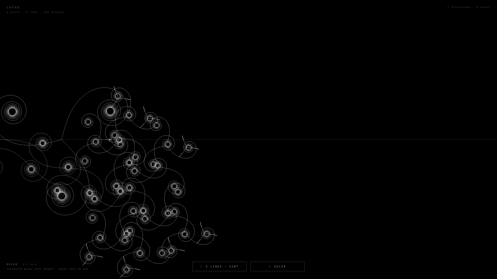

# LOCUS

*A point · a line · two actions.*

An entry for the JP Morgan challenge whose whole brief is "two buttons or actions".
One HTML file, no libraries, no backend, no colour: a black screen and grey lines that
grow slowly and fade slowly. A **locus** is the path traced by a point that moves
according to a rule. That is all this is.

**[▶ Open it in your browser](https://drgnfly5353.github.io/locus/)** · or [let it play itself](https://drgnfly5353.github.io/locus/?demo)

## Run it

Open `index.html` in any modern browser, or use the link above. Press **F** for
fullscreen, **R** to reset. On a phone, tap the two buttons.

## What you see

A faint horizontal line. A small bright point travels it in about a minute and wraps
around. Now and then the point sheds a seed: a form of lines leaving it in rotational
symmetry, each line a spiral drawn outward from the point.

When a line finishes, a new form buds from its tip, a little smaller, pointing away from
the form it grew from, and only where there is room. So one seed grows into a cascade of
spirals that spreads until it has enveloped the screen or its buds are too small to
matter. Every line fades over most of a minute, so the cascade dissolves from its origin
outward and the screen never clutters.

## The two actions

| | Key | What it does |
|---|---|---|
| **LINES** | Z, ←, 1, or the button | How many lines leave each form: 2, 3, 4, 5, 6, 8 or 12, shown with the angle between them (180°, 120°, 90°, 72°, 60°, 45°, 30°). |
| **SPIRAL** | X, →, 2, or the button | Which spiral every line is: Euler, curlicue, logarithmic, Fermat, Archimedean, Theodorus, hyperbolic, lituus. |

Each press sheds a seed at once with the new setting, and every bud anywhere on screen
takes the settings of the moment it buds. So the buttons steer the living thing: press
SPIRAL while an Euler cascade is spreading and its next buds are Fermat spirals.

## The spirals

One tracer draws all of them. A family is given by its heading φ as a function of a
parameter t and by its arc length rate ds/dt. The tracer steps a length h along the
heading, then moves t on by h / (ds/dt). The smooth spirals use h = 4 px. Two of them are
chord walks with a coarse h, and that is their whole definition.

- **Euler**  κ = 2a·s. Curvature grows in proportion to length: the clothoid of the Fresnel
  integrals, the curve roads use to ease into a bend. It winds into an eye at distance ½·√(π/a).
- **Curlicue**  The same law drawn in chords of h, alongside the smooth curve. The chords
  cannot be trapped by the eye. As the turn per chord grows they trace a hexagon, a pentagon,
  a square, a triangle and a dash, then escape, and the walk buds a new form where it comes
  to rest, so the chain goes on spiral after spiral. The chords are the partial sums
  Σ exp(iπ·s·n²) with s = a·h²/π, the theta sums of Berry and Goldberg.
- **Logarithmic**  r = k·e^(bθ) with b = ln φ / (π/2): the golden spiral, growing by the
  golden ratio every quarter turn. Self-similar at every scale; the nautilus.
- **Fermat**  r² = k·θ. The parabolic spiral. Its turns pack closer and closer; the pattern
  of sunflower seeds.
- **Archimedean**  r = k·θ. Evenly spaced turns.
- **Theodorus**  Right triangles with legs 1 and √n and hypotenuse √(n+1), one after another.
  The first seventeen hypotenuses are drawn, which is where Theodorus of Cyrene stopped.
- **Hyperbolic**  r = k/θ. Infinitely many turns at the centre, unrolling into a straight line.
- **Lituus**  r²·θ = k. The crozier: a tight coil that straightens into a ray.

Where a curve turns tightly the tracer speeds up, so eyes and cores whirl shut while the
open parts unfurl slowly. Each bud alternates its sense of rotation.

## The growth, precisely

A finished line buds if its tip is on screen, the bud would be at least 55 px, fewer
than 400 lines are growing, fewer than 140 000 points are on screen, and no other form's
centre lies within 1.6 bud-sizes of the tip. The bud is 0.92 times the size of its parent,
and its first line carries on in the direction from the parent's centre to the tip. These
few rules make the cascade colonise empty space and stop where it is crowded.

## The pitch, in two sentences

A point travels a line and sheds a spiral; the spiral buds more spirals until they envelop
the screen. One button says how many lines each has, the other says which spiral they are.

## Extras

- `index.html?demo` runs an autopilot that presses the buttons on a schedule, for a booth or a screenshot.
- `index.html?demo&t=60` skips ahead 60 seconds on load.
- Every constant is at the top of the script: lap time, fade time, cadence, sizes, decay, room, budgets, speeds.
- `preview-1.png`, `preview-2.png` and `preview-3.png` are frames from the autopilot.
